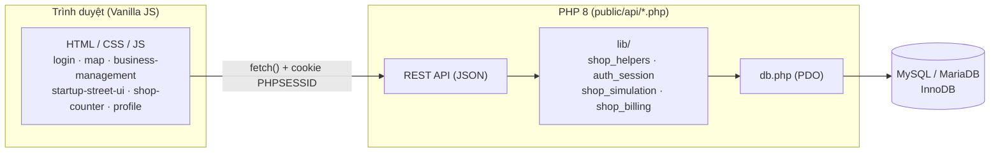

# 🏙️ Startup Street

**Startup Street** là game web mô phỏng khởi nghiệp / quản lý kinh doanh. Người chơi đăng ký tài khoản với vốn ban đầu **1.000.000.000đ**, đi dạo trên bản đồ phố, **thuê mặt bằng**, **mở cửa hàng** theo 6 mô hình kinh doanh, **nhập hàng – định giá – mở cửa**, rồi xem khách tự động ghé mua, chốt ca, trả phí hằng tháng và theo dõi tài chính.

> Nguyên tắc cốt lõi: **tiền, kho hàng, khách và giá đều do server (PHP + MySQL) quyết định**. Trình duyệt chỉ gọi API và vẽ kết quả, không bao giờ gửi số tiền / giá / số khách lên server.

---

## 📚 Mục lục

1. [Tổng quan công nghệ](#1-tổng-quan-công-nghệ)
2. [Kiến trúc hệ thống](#2-kiến-trúc-hệ-thống)
3. [Frontend](#3-frontend)
4. [Backend](#4-backend)
5. [Cơ sở dữ liệu](#5-cơ-sở-dữ-liệu)
6. [Danh sách API](#6-danh-sách-api)
7. [Các cơ chế game quan trọng](#7-các-cơ-chế-game-quan-trọng)
8. [Bảo mật](#8-bảo-mật)
9. [Kiểm thử](#9-kiểm-thử)
10. [Cấu trúc thư mục](#10-cấu-trúc-thư-mục)
11. [Cài đặt & chạy local](#11-cài-đặt--chạy-local)
12. [Các trang chính](#12-các-trang-chính)
13. [Phân công module](#13-phân-công-module)
14. [Hạn chế hiện tại](#14-hạn-chế-hiện-tại)

---

## 1. Tổng quan công nghệ

| Lớp | Công nghệ | Ghi chú |
|---|---|---|
| **Frontend** | HTML5, CSS3, **JavaScript thuần (ES6+)** | Không dùng framework (React/Vue), không cần build step |
| Đồ họa | **SVG** (bản đồ, nhân vật, cửa hàng), CSS animation, `requestAnimationFrame` | Bản đồ 2440×1240 vẽ bằng SVG sinh từ JS |
| Biểu đồ | **Chart.js 4.4.7** (CDN jsDelivr) | Biểu đồ doanh thu/chi phí, cơ cấu chi phí, chi tiêu cá nhân |
| Font | **Google Fonts**: Baloo 2, Nunito | Phong cách "cozy" hoạt hoạ |
| **Backend** | **PHP 8.x thuần** (không framework) | Mỗi file trong `public/api/` là một endpoint |
| Truy cập DB | **PDO + `pdo_mysql`** | Prepared statements, `ATTR_EMULATE_PREPARES = false` |
| Xác thực | **PHP Session** (cookie `PHPSESSID`) | `password_hash` / `password_verify` (bcrypt) |
| Giao thức API | **REST-style JSON** qua `fetch()` | Định dạng chung `{ success, message, data }` |
| **Database** | **MySQL / MariaDB** (InnoDB, `utf8mb4_unicode_ci`) | Hỗ trợ kết nối SSL (`ssl_ca`) |
| Migration | Script PHP CLI `tools/run_migration.php` + file `.sql` idempotent | 8 file migration `00` → `07` |
| Test | Integration test viết bằng PHP + **cURL** + PDO | `tests/shop_test.php` |
| Công cụ dev | PhpStorm (`.idea/`), Postman (`.postman/`), Git | Server dev: `php -S` |

---

## 2. Kiến trúc hệ thống



**Luồng xử lý một request điển hình** (ví dụ nhập hàng):

1. Frontend gọi `POST api/purchase-inventory.php` với `{shop_id, product_id, quantity, selling_price?}`.
2. Server lấy người chơi từ **session** (`getCurrentUserId()`), **không** nhận `user_id` từ client.
3. Mở transaction → khóa ví (`FOR UPDATE`) → kiểm tra chủ cửa hàng → kiểm tra sản phẩm, sức chứa kho, đủ tiền.
4. Trừ ví nguyên tử → cộng kho → ghi sổ `transactions` → `commit`.
5. Trả JSON `{success, message, data}`; frontend cập nhật giao diện từ dữ liệu server trả về.

---

## 3. Frontend

### 3.1. Công nghệ

- **HTML5 + CSS3 + JavaScript thuần (ES6+)**: `async/await`, `fetch`, arrow function, template literal, `Map/Set`, `URLSearchParams`, `IntersectionObserver` không dùng — tất cả chạy trực tiếp trên trình duyệt, **không npm, không bundler**.
- **CSS hiện đại**: CSS Variables (design token màu gỗ/giấy), CSS Grid + Flexbox, `clamp()`, `position: sticky`, keyframe animation, media query responsive, tôn trọng `prefers-reduced-motion`.
- **SVG động**: toàn bộ bản đồ phố (nhà, mái ngói, cây, đèn đường, ghế, người đi bộ) và nhân vật/avatar được **sinh bằng JavaScript** thành chuỗi SVG.
- **Chart.js 4.4.7** (nạp qua CDN `cdn.jsdelivr.net`) cho biểu đồ đường và biểu đồ doughnut.
- **Google Fonts** (Baloo 2, Nunito) cho phong cách giao diện game vui mắt.
- **localStorage**: chỉ lưu *thiết kế cửa hàng* (màu mặt tiền, kệ hàng, trang trí) với khóa `startupStreetDesigns`. **Không** lưu tiền hay kho.

### 3.2. Các trang & script

| Trang | Mục đích | Script / thư viện |
|---|---|---|
| `public/index.html` | Chuyển hướng sang `login.html` | — |
| `public/login.html` | Đăng nhập / đăng ký, nền thị trấn hoạt hình | JS inline, `fetch` tới `api/auth/*` |
| `public/map.php` | **Bản đồ phố** (có guard session phía PHP), thuê mặt bằng, tùy chỉnh mặt tiền | JS inline, SVG, game loop |
| `public/business-management.html` | Quản lý cửa hàng & kho: nhập hàng, đổi giá, thêm mặt hàng, đóng cửa vĩnh viễn | JS inline |
| `public/shop-counter.html` | Bên trong cửa hàng: khách vào mua, mở/đóng cửa quán | `js/shop-scene.js` |
| `public/startup-street-ui.html` | Dashboard vận hành: nhật ký, kho, báo cáo ngày, tài chính, sổ cái | `js/game.js`, `js/wallet-api.js`, `js/shop-scene.js`, `js/shop-live.js`, Chart.js |
| `public/profile.html` | Hồ sơ, **tùy chỉnh avatar**, quản lý chi tiêu cá nhân | JS inline, Chart.js |

### 3.3. Các module JavaScript dùng chung (`public/js/`)

| File | Vai trò |
|---|---|
| `game.js` | Động cơ **demo cục bộ**: `GameState`, menu mẫu, tính doanh thu/chi phí, báo cáo ngày, vẽ biểu đồ Chart.js |
| `wallet-api.js` | **Cầu nối game.js ↔ MySQL**: ghi đè các hàm đụng tới tiền (bán, nhập hàng, chốt ca) để gọi API; có 2 chế độ *thật* (có `?shop_id=`) và *demo* (không có) |
| `shop-live.js` | Vòng lặp **polling 4 giây** gọi `shop-tick.php`, vẽ nhật ký khách, nút mở/đóng cửa |
| `shop-scene.js` | Cảnh trong quán: khách (SVG) bước vào, nói món, nhận hàng, "+tiền" nổi lên rồi ra về; chỉ **vẽ**, không quyết định tiền |

### 3.4. Điểm kỹ thuật đáng chú ý ở frontend

- **Game loop trên bản đồ**: `requestAnimationFrame`, di chuyển bằng **WASD / phím mũi tên**, va chạm với nhà (AABB), camera mượt (lerp), NPC đi bộ theo làn đường.
- **Sinh bản đồ xác định (deterministic)**: bộ random **Mulberry32** với seed `20260117`, nên mã lô / giá / diện tích trên bản đồ **khớp đúng** với bảng `properties` trong migration `03`.
- **Avatar procedural**: avatar và khách trong quán được vẽ bằng SVG từ các tham số (màu da, kiểu tóc, mắt, trang phục, mũ, kính, nhóm tuổi).
- **Chống XSS ở UI**: dữ liệu từ server được escape (`esc()`), tên cửa hàng gán qua `textContent`.
- **Xử lý 401 tập trung**: mọi `fetch` gặp HTTP 401 đều chuyển về `login.html`.
- **Hàng đợi đơn hàng** (`chain = Promise`) trong `wallet-api.js` để các đơn bắn liên tiếp được áp dụng đúng thứ tự.
- **Accessibility cơ bản**: `aria-label`, `role="dialog"`, `aria-live`, `:focus-visible`, `[hidden]`.

---

## 4. Backend

### 4.1. Công nghệ

- **PHP 8.x thuần**, không framework, không Composer. Mỗi endpoint là một file PHP độc lập trong `public/api/`, dùng chung thư viện trong `lib/`.
- **PDO (`pdo_mysql`)** với prepared statements, `ERRMODE_EXCEPTION`, `FETCH_ASSOC`, tắt emulate prepares.
- Tương thích **PHP ≥ 8.4** (`\Pdo\Mysql::ATTR_SSL_CA`) và PHP < 8.4 (`PDO::MYSQL_ATTR_SSL_CA`).
- Máy chủ phát triển: **PHP built-in server** (`php -S 127.0.0.1:8000 -t public`).

### 4.2. Thư viện nội bộ (`lib/`)

| File | Chức năng |
|---|---|
| `db.php` (gốc dự án) | Kết nối PDO dùng chung, đọc `config/config.local.php`, trả lỗi dạng JSON, bắt lỗi fatal |
| `lib/shop_helpers.php` | `apiRespond`, `ApiException`, `requireMethod`, `readJsonBody`, `toPositiveInt/Number`, `getCurrentUserId`, `requireOwnedShop`, `getWalletBalance`, `deductWallet`, `creditWallet`, `deductShopInventoryAndAddBalance` + các hằng số cân bằng game |
| `lib/auth_session.php` | Khởi tạo / huỷ session an toàn (không phụ thuộc DB nên logout vẫn chạy khi MySQL lỗi) |
| `lib/shop_simulation.php` | **Động cơ khách tự động**: phân phối Poisson, hệ số giờ cao điểm, hệ số giá, uy tín, két quán |
| `lib/shop_billing.php` | **Phí cố định theo tháng** (mặt bằng + điện nước + lương) thu "lười" khi tick |

### 4.3. Quy ước API

- Mọi response có dạng:

```json
{ "success": true, "message": "Lấy số dư thành công", "data": { "...": "..." } }
```

- Mã HTTP có ý nghĩa: `200/201` thành công, `400` dữ liệu sai, `401` chưa đăng nhập, `403` không phải chủ, `404` không tồn tại, `405` sai method, `409` xung đột (hết hàng, trùng, kho đầy…), `410` tính năng đã tắt, `500` lỗi server.
- Lỗi nghiệp vụ ném `ApiException(message, httpStatus, data)`, được bắt ở mỗi endpoint rồi chuyển thành JSON.

### 4.4. Xác thực & phiên

- **PHP Session** với cấu hình: `use_strict_mode`, `use_only_cookies`, `cookie_httponly`, `cookie_samesite=Lax`, `cookie_secure` (tự bật khi chạy HTTPS).
- `session_regenerate_id(true)` khi đăng nhập / đăng ký để chống **session fixation**.
- Mật khẩu băm bằng **`password_hash(PASSWORD_DEFAULT)`** (bcrypt), có `password_needs_rehash`.
- Đăng nhập luôn chạy `password_verify` với **hash giả** khi không tìm thấy user, để thời gian phản hồi như nhau (chống dò tài khoản).
- `getCurrentUserId()` dùng `read_and_close` để nhả khóa file session ngay, các request song song không bị xếp hàng.

### 4.5. Giao dịch & đồng thời (concurrency)

- Mọi thao tác động tới tiền/kho chạy trong **transaction InnoDB** với `SELECT ... FOR UPDATE`.
- **Thứ tự khóa cố định**: `ví → cửa hàng → shop_runtime → kho` để tránh deadlock.
- Trừ tiền **nguyên tử**: `UPDATE users SET balance = balance - ? WHERE id = ? AND balance >= ?` (kiểm tra số dư ngay trong câu lệnh).
- Ràng buộc **UNIQUE** ở tầng DB là chốt chặn cuối cùng: `rentals.property_id`, `shops.property_id`, `inventory(shop_id, product_id)`.
- Sổ cái `transactions` là **tùy chọn**: lỗi ghi sổ không làm hỏng giao dịch chính.

---

## 5. Cơ sở dữ liệu

**MySQL / MariaDB**, engine **InnoDB**, bảng mã **`utf8mb4_unicode_ci`** (hỗ trợ tiếng Việt và emoji).

### 5.1. Các bảng

| Nhóm | Bảng | Mô tả |
|---|---|---|
| Tài khoản | `users` | Tài khoản, `balance` (nguồn sự thật duy nhất của tiền), `password_hash` |
| | `player_profiles` | Avatar (tuổi, da, tóc, mắt, trang phục, mũ, kính), theme, tên hiển thị |
| | `personal_expenses` | Chi tiêu cá nhân theo danh mục / tháng |
| Mặt bằng | `properties` | 48 mặt bằng (A1–D12): lượng khách, diện tích, giá, trạng thái `available` / `npc` |
| | `rentals` | Ai đang thuê mặt bằng nào (UNIQUE theo `property_id`) |
| Cửa hàng | `business_types` | 6 mô hình: trà sữa, quán ăn, tiệm bánh, shop quần áo, tiệm hoa, tạp hóa |
| | `products` | Sản phẩm theo mô hình; `shop_id` NULL = món có sẵn, có giá trị = món do chủ quán tự thêm; `emoji`, `default_price` |
| | `shops` | Cửa hàng (1 mặt bằng ↔ 1 cửa hàng) |
| | `inventory` | Tồn kho + giá bán từng món của từng cửa hàng |
| Vận hành | `shop_runtime` | Trạng thái mở/đóng, mốc tick, uy tín, bộ đếm, **két quán** (`till_balance`), mốc chốt ca, mốc thu phí |
| | `shop_orders` | Mỗi khách vào quán (`served` / `missed`) |
| Tài chính | `transactions` | Sổ cái thu/chi (sale, material, rent, salary, utilities…) |
| | `cycle_reports`, `cycle_sales_detail` | Báo cáo chu kỳ & chi tiết bán theo chu kỳ |

### 5.2. Migration

Chạy theo thứ tự, **idempotent** (chạy lại nhiều lần vẫn an toàn nhờ `CREATE TABLE IF NOT EXISTS`, kiểm tra `information_schema` + `PREPARE/EXECUTE`, `INSERT IGNORE`):

| File | Nội dung |
|---|---|
| `00_users_auth.sql` | `users`, `player_profiles`, `personal_expenses` |
| `01_simulation_finance.sql` | `transactions`, `cycle_reports`, `cycle_sales_detail` |
| `02_shops_inventory.sql` | `business_types`, `products`, `shops`, `inventory` + dữ liệu mẫu (6 loại hình × 4 sản phẩm) |
| `03_properties_rentals.sql` | `properties` (48 lô), `rentals` |
| `04_shop_runtime.sql` | `shop_runtime`, `shop_orders` |
| `05_custom_products.sql` | Thêm `products.shop_id` (món riêng của cửa hàng) |
| `06_settlement.sql` | Két quán, chốt ca, mốc thu phí tháng |
| `07_product_emoji.sql` | `products.emoji`, `products.default_price` |

Chạy tất cả: `php tools/run_migration.php`

---

## 6. Danh sách API

### Xác thực & hồ sơ — `public/api/auth/`

| Endpoint | Method | Chức năng |
|---|---|---|
| `register.php` | POST | Đăng ký, cấp vốn ban đầu, tạo profile mặc định, mở session |
| `login.php` | POST | Đăng nhập bằng username hoặc email |
| `logout.php` | POST | Huỷ session + xoá cookie (không cần DB) |
| `me.php` | GET | Thông tin người dùng hiện tại + profile + số dư |
| `update-profile.php` | POST | Cập nhật tên hiển thị, theme, avatar |
| `expenses.php` | GET / POST / DELETE | Chi tiêu cá nhân theo tháng |

### Mặt bằng & ví — `public/api/`

| Endpoint | Method | Chức năng |
|---|---|---|
| `get-balance.php` | GET | Số dư thật của người đang đăng nhập |
| `get-occupied-properties.php` | GET | Mặt bằng đã có chủ / NPC, `is_mine` (không lộ chủ là ai) |
| `rent-property.php` | POST | Thuê mặt bằng (giá lấy từ server, idempotent) |

### Cửa hàng & kho

| Endpoint | Method | Chức năng |
|---|---|---|
| `business-types.php` | GET | Danh mục mô hình kinh doanh |
| `create-shop.php` | POST | Mở cửa hàng trên mặt bằng đã thuê (kiểm tra vốn yêu cầu) |
| `get-shops.php` | GET | Cửa hàng của người chơi |
| `get-shop-products.php` | GET | Sản phẩm + tồn kho + giá bán + số dư |
| `purchase-inventory.php` | POST | Nhập 1 món (trừ ví + cộng kho trong 1 transaction) |
| `restock-bulk.php` | POST | Nhập nhiều món, **all-or-nothing** |
| `add-product.php` | POST | Thêm mặt hàng riêng (icon, giá vốn, giá bán) |
| `update-shop-name.php` | POST | Đổi tên cửa hàng |
| `close-shop.php` | POST | **Đóng cửa vĩnh viễn**: trả két, thanh lý kho 50% giá vốn, trả mặt bằng |
| `sell-product.php` | POST | Bán thủ công — **đã tắt** (trả `410`), khách giờ mua tự động |

### Mô phỏng & tài chính

| Endpoint | Method | Chức năng |
|---|---|---|
| `shop-open.php` | POST | Mở / đóng cửa quán |
| `shop-tick.php` | POST | Cho khách ghé từ lần tick trước, trả trạng thái để vẽ |
| `end-day.php` | POST | **Chốt ca**: chuyển doanh thu trong két vào ví, trả số liệu báo cáo ca |

---

## 7. Các cơ chế game quan trọng

### 7.1. Khách tự động (server-side simulation)

- Không dùng cron: server tính khách **"lười"** mỗi khi có request `shop-tick`.
- Số khách ≈ **Poisson** (thuật toán Knuth) với tốc độ phụ thuộc: lượng khách qua lại của mặt bằng, **uy tín**, **giờ trong ngày** (cao điểm sáng / trưa / chiều tối, thấp điểm khuya).
- **Hệ số giá**: giá bán so với giá thị trường (`giá vốn × 1.8`). Bán quá đắt → khách "chê" và đi ngang qua; bán rẻ → khách mua nhiều hơn.
- Hết hàng → khách bỏ về, mất uy tín. Phục vụ thành công → tăng uy tín.
- Người chơi vắng mặt vẫn được **bù khách** (tối đa 10 phút) khi quay lại; mỗi tick tối đa 40 khách.
- Gọi tick nhiều lần / nhiều tab **không nhân đôi khách** nhờ khóa `shop_runtime` và cập nhật `last_tick_ts` trong cùng transaction.

### 7.2. Két quán & chốt ca

- Doanh thu khách trả vào **két quán** (`shop_runtime.till_balance`), chưa vào ví.
- **Chốt ca** (`end-day.php`) chuyển toàn bộ két vào ví và ghi sổ. Lãi ca (`doanh thu − giá vốn`) chỉ để **báo cáo** vì tiền nhập hàng đã bị trừ lúc nhập (tránh trừ giá vốn hai lần).

### 7.3. Phí hằng tháng

- Mỗi 30 ngày (`BILLING_PERIOD_DAYS`): tiền thuê mặt bằng = **5% giá mặt bằng**, điện nước **2.000.000đ**, lương (mặc định 0).
- Ví không đủ → quán **bị buộc đóng cửa** cho tới khi chốt ca lấy doanh thu và đủ tiền.

### 7.4. Các hằng số cân bằng game (chỉnh trong code, không cần sửa logic)

| Hằng số | Giá trị | File |
|---|---|---|
| Vốn ban đầu | 1.000.000.000đ | `00_users_auth.sql` |
| Sức chứa kho mỗi món | 40 | `shop_helpers.php` |
| Hệ số giá bán mặc định | ×1.5 giá vốn | `shop_helpers.php` |
| Hệ số giá thị trường | ×1.8 giá vốn | `shop_simulation.php` |
| Bù khách tối đa khi vắng mặt | 600 giây | `shop_simulation.php` |
| Hoàn thanh lý khi đóng cửa | 50% giá vốn | `close-shop.php` |
| Số món riêng tối đa / cửa hàng | 20 | `add-product.php` |

---

## 8. Bảo mật

- **Không tin client**: user id luôn lấy từ session; tiền, giá, số khách do server tính.
- **SQL Injection**: 100% truy vấn dùng prepared statements, tắt emulate prepares.
- **Phân quyền theo chủ sở hữu**: `requireOwnedShop()` trả 404 / 403; `UPDATE` còn kèm `owner_user_id` làm lớp bảo vệ thứ hai.
- **Chống lộ thông tin**: `get-occupied-properties.php` không tiết lộ ai là chủ mặt bằng; `create-shop.php` trả chung 403 cho "không tồn tại" và "của người khác".
- **Session**: HttpOnly, SameSite=Lax, Secure khi HTTPS, strict mode, regenerate id.
- **Mật khẩu**: bcrypt, giới hạn 72 byte, chống dò tài khoản bằng timing.
- **Validate đầu vào chặt**: `toPositiveInt`, `toPositiveNumber`, kiểu dữ liệu chuỗi bắt buộc, giới hạn độ dài, regex `/D`.
- **XSS**: escape dữ liệu khi render HTML ở frontend; emoji chỉ nhận ký tự ngoài ASCII (tối đa 8 ký tự).
- **Chống race condition**: `FOR UPDATE`, UNIQUE key, UPDATE có điều kiện.
- **Bí mật**: `config/config.local.php`, `*.pem`, `.env` nằm trong `.gitignore`.

---

## 9. Kiểm thử

`tests/shop_test.php` là **integration test dạng black-box**:

- Gọi API thật qua **cURL** (mỗi người chơi một cookie jar = một session).
- Đối chiếu **sự thật từ MySQL** (đọc thẳng bằng PDO), không tin vào chính API đang test.
- Kịch bản kiểm tra: tạo cửa hàng trùng mặt bằng (409), không đủ tiền nhập hàng, sản phẩm khác loại hình (404), truy cập cửa hàng của người khác (403), số lượng không hợp lệ (400), mặt bằng không tồn tại (403/404).
- Dữ liệu test dùng tiền tố `TESTSUITE-` và `property_id` giả `9900001/9900002`, **tự dọn và khôi phục số dư** khi kết thúc (kể cả khi lỗi).

```bash
php -S 127.0.0.1:8000 -t public     # terminal 1
php tests/shop_test.php             # terminal 2   (thêm -v để xem từng request)
```

> ⚠️ Test **ghi vào database** — chỉ chạy trên DB phát triển, không chạy trên production. Test dùng một endpoint đăng nhập dev (`dev-login.php`, chỉ cho `127.0.0.1`); hãy xoá nó khi triển khai thật hoặc truyền `--login-url` khác.

---

## 10. Cấu trúc thư mục

```text
startup-street/
├── .idea/                          # Cấu hình PhpStorm
├── .postman/                       # Workspace Postman
├── certs/                          # Chứng chỉ SSL CA cho MySQL (ca.pem, không commit)
├── config/
│   ├── config.example.php          # File mẫu
│   └── config.local.php            # Cấu hình thật (tự tạo, không commit)
├── database/
│   └── migrations/                 # 00 → 07 (.sql, idempotent)
├── lib/
│   ├── auth_session.php            # Session đăng nhập / đăng xuất
│   ├── shop_helpers.php            # Helper API, ví, quyền sở hữu, hằng số game
│   ├── shop_simulation.php         # Động cơ khách tự động
│   └── shop_billing.php            # Phí tháng
├── public/                         # Document root của web server
│   ├── api/
│   │   ├── auth/                   # login, register, logout, me, update-profile, expenses
│   │   ├── rent-property.php
│   │   ├── create-shop.php  get-shops.php  get-shop-products.php
│   │   ├── purchase-inventory.php  restock-bulk.php  add-product.php
│   │   ├── update-shop-name.php  close-shop.php  sell-product.php
│   │   ├── shop-open.php  shop-tick.php  end-day.php
│   │   └── get-balance.php  get-occupied-properties.php  business-types.php
│   ├── js/
│   │   ├── game.js  wallet-api.js  shop-live.js  shop-scene.js
│   ├── index.html  login.html  map.php  profile.html
│   ├── business-management.html  shop-counter.html  startup-street-ui.html
├── tests/
│   └── shop_test.php               # Integration test
├── tools/
│   └── run_migration.php           # Chạy migration bằng CLI
├── db.php                          # Kết nối PDO dùng chung
├── .gitignore
└── README.md
```

---

## 11. Cài đặt & chạy local

### Yêu cầu

- **PHP 8.x** với extension **`pdo_mysql`** (và `curl` nếu chạy test, `mbstring` được khuyến nghị)
- **MySQL / MariaDB**
- Trình duyệt hiện đại (có kết nối Internet để nạp Chart.js và Google Fonts từ CDN)

### Các bước

1. **Tạo file cấu hình**

   ```bash
   # Windows
   copy config\config.example.php config\config.local.php
   # macOS / Linux
   cp config/config.example.php config/config.local.php
   ```

2. **Điền thông tin MySQL** vào `config/config.local.php`:

   ```php
   return [
       'host'     => 'YOUR_MYSQL_HOST',
       'port'     => 3306,
       'database' => 'street_business_game',
       'username' => 'YOUR_MYSQL_USERNAME',
       'password' => 'YOUR_MYSQL_PASSWORD',
       'ssl_ca'   => __DIR__ . '/../certs/ca.pem', // bỏ trống nếu DB không dùng SSL
   ];
   ```

3. **Chạy migration** (tạo bảng + dữ liệu mẫu):

   ```bash
   php tools/run_migration.php
   ```

4. **Khởi động server** từ thư mục gốc dự án:

   ```bash
   php -S 127.0.0.1:8000 -t public
   ```

5. **Mở trình duyệt**: <http://127.0.0.1:8000/login.html> → đăng ký tài khoản → vào game.

> Các trang sau khi đăng nhập dùng **session**, không còn truyền `?user_id=` trên URL. Tham số URL còn dùng: `?shop_id=<id>` và `?property_id=<id>` (trang quản lý cửa hàng).

### Xử lý sự cố nhanh

| Lỗi | Cách xử lý |
|---|---|
| "Thiếu extension pdo_mysql" | Bật `extension=pdo_mysql` trong `php.ini` rồi chạy lại server |
| "Thiếu file config/config.local.php" | Làm lại bước 1–2 |
| "Không tìm thấy file chứng chỉ SSL CA" | Đặt đúng `certs/ca.pem` hoặc để `ssl_ca` rỗng |
| Lỗi thiếu bảng / cột (`42S02`, `42S22`) | Chạy lại `php tools/run_migration.php` |

---

## 12. Các trang chính

### 🗺️ Bản đồ & thuê mặt bằng — `public/map.php`
Bản đồ SVG 48 mặt bằng (4 dãy A–D × 12 lô), đi lại bằng WASD, nhấn **E** để xem mặt bằng. Trạng thái: *Còn trống / Đã có chủ / Của bạn*. Thuê mặt bằng → tạo cửa hàng → tùy chỉnh mặt tiền, nội thất, hàng hóa, trang trí.

### 📦 Quản lý cửa hàng & kho — `public/business-management.html`
Danh sách cửa hàng, tìm kiếm / lọc sản phẩm (còn hàng, sắp hết, hết hàng), nhập hàng từng món hoặc **bổ sung đầy kho** hàng loạt, chỉnh giá bán (hiển thị % lãi/lỗ), **thêm mặt hàng riêng**, **đóng cửa vĩnh viễn**.

### 🏪 Trong cửa hàng — `public/shop-counter.html`
Cảnh nội thất sống động: khách bước vào, nói món, nhận hàng, trả tiền rồi ra về; hết hàng thì khách buồn bỏ đi; chê giá thì chỉ đi ngang qua cửa kính. Nút mở/đóng cửa quán.

### 📊 Dashboard vận hành & tài chính — `public/startup-street-ui.html`
Nhật ký hoạt động, tồn kho thật, báo cáo ngày (chốt ca), nhận xét khách hàng, biểu đồ doanh thu vs chi phí, cơ cấu chi phí, sổ cái giao dịch.

### 👤 Hồ sơ cá nhân — `public/profile.html`
Tùy chỉnh avatar (nhóm tuổi, da, tóc, mắt, trang phục, mũ, kính), tên hiển thị, giao diện màu, và **quản lý chi tiêu cá nhân** theo tháng kèm biểu đồ.

---

## 13. Phân công module

| Module | Phạm vi |
|---|---|
| **Thành viên 1** | Tài khoản, đăng nhập / đăng ký, session, hồ sơ & avatar, chi tiêu cá nhân |
| **Thành viên 2** | Bản đồ, mặt bằng, thuê mặt bằng |
| **Thành viên 3** | Cửa hàng, mô hình kinh doanh, kho hàng, nhập hàng |
| **Thành viên 4** | Mô phỏng khách, két quán, chốt ca, phí tháng, sổ cái & dashboard tài chính |

---

## 14. Hạn chế hiện tại

- `game.js` còn **menu demo cứng** (4 món trà sữa); màn hình vận hành hiện chỉ bán được với mô hình *Trà sữa & đồ uống* (id = 1). Các mô hình khác vẫn nhập hàng được ở trang Kho hàng.
- Số liệu báo cáo ngày, biểu đồ và sổ cái trên `startup-street-ui.html` được tính **trong phiên** và mất khi tải lại trang (số dư ví và lịch sử `transactions` thì lưu thật ở server).
- Thiết kế mặt tiền lưu ở **localStorage** của trình duyệt (chỉ tên cửa hàng được đồng bộ lên server).
- Khách được mô phỏng bằng **polling 4 giây** (chưa dùng WebSocket / SSE).
- Cần Internet để nạp **Chart.js** và **Google Fonts** từ CDN.
- Chưa có CSRF token riêng (đang dựa vào `SameSite=Lax`), chưa có giới hạn tần suất đăng nhập (rate limiting).

---

## 🎯 Mục tiêu dự án

Mô phỏng kinh doanh thực tế dưới dạng game web, gồm các module: giao dịch mặt bằng, chọn mô hình kinh doanh, quản lý kho & giá bán, mô phỏng khách hàng, tính toán chi phí – lợi nhuận, và dashboard tài chính.
